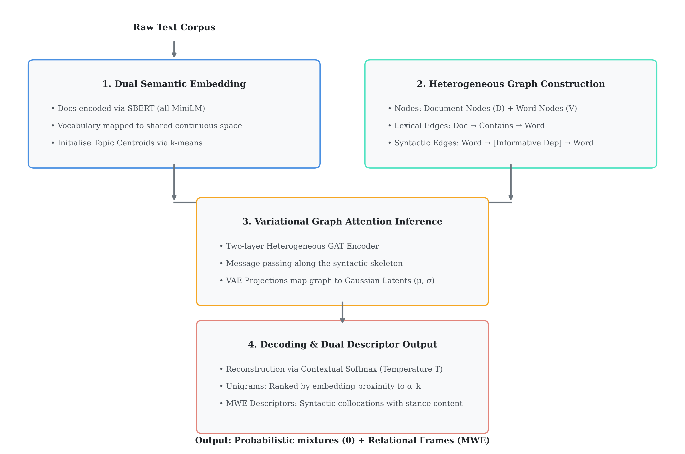

# SCPTM

Two Python packages for topic modelling with syntactic structure.

Both parse a corpus once with a dependency parser, link lemmas by the dependency
relations found in it, and use those links inside the model. They are independent
distributions: neither imports the other, and either can be installed alone.

| package | import | model | 500 docs, K=6 |
|---|---|---|---|
| `scptm` | `scptm` | SBERT embeddings, heterogeneous graph, variational graph encoder | 70.2 s, NPMI 0.279 |
| `scptm-bow` | `scptm_bow` | dependency-regularised NMF over a lemmatised bag of words, fastText vectors | 18.1 s, NPMI 0.334 |

Timings and scores are from 20 Newsgroups (500 documents, vocabulary 1,377
lemmas); the `scptm-bow` figure is with the default KL divergence.

[](https://pypi.org/project/scptm/)
[](https://pypi.org/project/scptm-bow/)
[](https://github.com/a-meneghini/scptm/actions/workflows/ci.yml)
[](https://pypi.org/project/scptm/)
[](LICENSE)



*The `scptm` pipeline. `scptm-bow` uses steps 1, 2 and 4 — word vectors,
dependency edges, MWE extraction — and replaces step 3 with a matrix
factorisation.*

## Installation

```bash
pip install scptm            # requires torch and sentence-transformers
pip install scptm-bow        # numpy, scipy, scikit-learn
```

Extras for `scptm-bow`: `[udpipe]` (UDPipe lemmatiser instead of spaCy),
`[vectors]` (fastText), `[plots]` (2D projection), `[full]`.

## Usage

```python
from scptm_bow import BowSCPTM

model = BowSCPTM(num_topics=20, lang="ita", parser_backend="udpipe")
model.fit(documents, cache_path="corpus.pkl")

model.theta          # (n_docs, K)   document-topic
model.topic_word     # (K, n_vocab)  topic-term
model.top_words(10)  # list[list[str]]
model.get_topic_info(10)   # list of dicts: topic_id, size, top_words, label, mwes
model.get_mwes()           # multiword expressions per topic
model.transform(new_documents)   # fold in, H fixed
```

The neural package exposes the same entry points plus `plot_training()` and
`visualize_3d()`.

Both ship a command line interface:

```bash
scptm-bow fit corpus.txt --topics 20 --lang ita --parser udpipe --out model.json
scptm-bow topics model.json
scptm-bow evaluate model.json heldout.txt      # held-out perplexity
```

## Metrics

`scptm.metrics` and `scptm_bow.metrics` return the same keys —
`c_v` (Röder et al. 2015), `npmi`, `diversity`, `exclusivity`, `redundancy` — so
scores from the two packages are comparable. Both implementations are checked
against a frozen fixture in [`conformance/`](conformance), so a divergence
between them fails a test rather than going unnoticed.

## Evaluation utilities

`scptm_bow` also contains the pieces needed to report a comparison rather than a
point estimate:

- `graphs.random_graph_matched(graph)` — 2-edge-swap randomisation that preserves
  each word's degree and the edge count, so the syntactic edges can be compared
  against a graph with the same size but no linguistic content.
- `stats.paired_bootstrap_ci(a, b)` — confidence interval for the difference
  between two models measured on the same seeds; `cliffs_delta` for the effect
  size. `wilcoxon_paired` warns when the sample is too small for the test to be
  able to reject.
- `BenchmarkSpec` / `run` / `compare` — a resumable corpus × model × seed × K
  sweep that writes one row per fit and emits a booktabs table.
- `model.heldout_perplexity(docs)`, `model.bootstrap()`,
  `model.estimate_effect(covariates)`, `model.temporal_prevalence(timestamps)`.

## Repository layout

```
packages/
  scptm/        src layout, tests, README, CITATION
  scptm-bow/    src layout, tests, README, CITATION
conformance/    shared metric fixture, reproduced by both test suites
paper/          the paper's analyses and figures; paper/DATA.md = data provenance
.github/        ci.yml (lint + 121 tests, Python 3.10-3.12), publish.yml
```

Local setup:

```bash
git clone https://github.com/a-meneghini/scptm && cd scptm
python -m venv .venv && . .venv/bin/activate
pip install -e packages/scptm -e packages/scptm-bow
for f in packages/*/tests/test_*.py; do python "$f" || exit 1; done
```

## Data

No corpus is redistributed here. [`paper/DATA.md`](paper/DATA.md) records the
source, licence and reproduction notes for each dataset used in the paper.

## Citation

See [`CITATION.cff`](CITATION.cff). Reference paper: *Does Syntax Matter? A
Graph-Augmented Variational Topic Model for Computational Social Sciences*.

## Licence

MIT — see [`LICENSE`](LICENSE).
